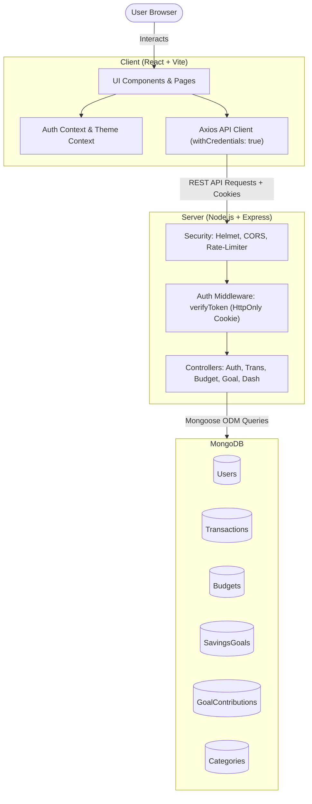

# 🎓 Personal Finance Tracker (FinTrack) - Viva & Project Defense Guide

> **Prepared for:** Final Year / Semester Project Viva Voce & Presentation  
> **Project Title:** FinTrack - Modern Personal Finance & Budget Tracking Web Application  
> **Tech Stack:** MERN Stack (MongoDB, Express.js, React 19, Node.js) + Tailwind CSS  
> **Author / Student:** Om Chauhan (`om40@gmail.com`)

---

## 📑 Table of Contents
1. [Project Overview & Elevator Pitch](#1-project-overview--elevator-pitch)
2. [Problem Statement & Motivation](#2-problem-statement--motivation)
3. [Technology Stack & Justifications](#3-technology-stack--justifications)
4. [System Architecture & Data Flow](#4-system-architecture--data-flow)
5. [Database Design & Schema Architecture](#5-database-design--schema-architecture)
6. [Key Features & Functional Modules](#6-key-features--functional-modules)
7. [Security & Performance Optimizations](#7-security--performance-optimizations)
8. [Step-by-Step 5-Minute Live Demo Script](#8-step-by-step-5-minute-live-demo-script)
9. [Top 25 Viva Questions & Model Answers](#9-top-25-viva-questions--model-answers)
10. [Future Scope & Conclusion](#10-future-scope--conclusion)

---

## 1. Project Overview & Elevator Pitch

### What to say in 30 seconds:
> *"Good morning respected examiners. My project is **FinTrack**, a full-stack personal finance and wealth management platform built using the MERN stack. It empowers users to take full control of their money through automated expense tracking, real-time budget threshold warnings, visual savings goal ledgers, and interactive visual analytics. It is designed with enterprise-grade security including HTTP-only cookie-based JWT authentication, integer-based currency precision to prevent floating-point calculation errors, and an adaptive dark/light responsive design."*

---

## 2. Problem Statement & Motivation

### The Problem:
- **Lack of Financial Visibility:** Most individuals struggle with unorganized expenses across bank transfers, UPI, credit cards, and cash.
- **Overspending without Warning:** Traditional spreadsheets do not proactively warn users when they are crossing 80% or 100% of their monthly category budgets.
- **Security Vulnerabilities in Existing Apps:** Many web applications store access tokens in `localStorage`, making them vulnerable to Cross-Site Scripting (XSS) token theft.
- **Financial Calculation Inaccuracies:** Using floating point numbers (e.g., `0.1 + 0.2 = 0.30000000000000004`) in financial databases introduces monetary rounding errors.

### The Solution:
- **Unified Multi-Account Ledger:** Consolidated records for UPI, Card, Net Banking, and Cash.
- **Threshold-Driven Budget Guard:** Proactive visual alerts (Green for on-track, Amber at 80%+, Red at 100%+ limit exceeded).
- **Hardened Security:** HttpOnly, SameSite JWT cookies + bcrypt hashing + helmet + rate-limiting.
- **Minor-Unit Financial Math:** Storing all currency amounts as integers (Paise / Cents: ₹100 = `10000`) ensuring 100% mathematical accuracy.

---

## 3. Technology Stack & Justifications

| Tier | Technology | Why Chosen? (Viva Justification) |
|---|---|---|
| **Frontend UI** | **React 19 + Vite** | Component reusability, virtual DOM performance, ultra-fast Hot Module Replacement (HMR) with Vite build engine. |
| **Styling** | **Tailwind CSS 4** | Utility-first CSS, custom `@custom-variant dark` support, zero runtime overhead, responsive utility classes. |
| **Charts** | **Recharts** | Declarative D3-based charting components built specifically for React, with smooth animations and tooltips. |
| **State & Routing**| **React Context API + React Router v7** | Lightweight state management for Authentication & Theme without external boilerplate like Redux; client-side routing with protected route guards. |
| **Backend Runtime**| **Node.js + Express.js** | Non-blocking event-driven I/O ideal for RESTful API concurrency; minimal and scalable middleware architecture. |
| **Database** | **MongoDB (Local/Atlas) + Mongoose** | Flexible JSON-like document model matching React object structures; compound indexing for fast filtered searches; Mongoose schema validation. |
| **Security** | **JWT, bcryptjs, Helmet** | Stateless authentication, 12-round salt hashing for passwords, automated HTTP security headers, and brute-force rate-limiting. |

---

## 4. System Architecture & Data Flow

---

## 5. Database Design & Schema Architecture

### Key Collections & Design Decisions:

#### 1. `User` Schema
- Fields: `name`, `email` (unique, trimmed, lowercase), `passwordHash` (hidden with `select: false`), `preferredCurrency`, `theme`.
- **Pre-save Hook:** Hashes password with `bcrypt.genSalt(12)` whenever password is changed.

#### 2. `Transaction` Schema
- Fields: `userId`, `title`, `amountMinor` (Number in paise), `type` (`income` | `expense`), `category` (String), `date` (Date), `paymentMethod`, `notes`, `tags`.
- **Compound Indexes:** 
  - `{ userId: 1, date: -1 }` (Speed up reverse chronological feed)
  - `{ userId: 1, type: 1, date: -1 }` (Speed up income vs expense reports)

#### 3. `Budget` Schema
- Fields: `userId`, `category`, `amountMinor`, `period` (`monthly`, `weekly`, `yearly`), `startDate`, `endDate`.
- **Aggregation Pipeline:** Uses `$match` on user, category, and date range, then `$group` with `$sum: '$amountMinor'` to calculate real-time spending vs limit.

#### 4. `SavingsGoal` & `GoalContribution` Schema
- Two-tier ledger architecture: `SavingsGoal` maintains high-level target and current progress, while `GoalContribution` records every single deposit or withdrawal timestamped with notes.

---

## 6. Key Features & Functional Modules

1. **Executive Dashboard (`DashboardPage.jsx`):**
   - KPI Cards: Net Balance, Total Income, Total Expenses, Savings Rate.
   - Interactive Recharts: Dual-gradient Area Chart (Income vs Expense) and Donut Chart (Category Spending).
   - Timeframe Filtering: Real-time calculation across *This Month*, *Last Month*, *This Year*, and *All Time*.

2. **Transaction Management (`TransactionsPage.jsx`):**
   - Multi-criteria filtering: Search keywords, Transaction Type, Category, Payment Method, Custom Date Range.
   - Dynamic sorting: Date (Newest/Oldest), Amount (Highest/Lowest).
   - Server-side pagination (`skip` and `limit`).

3. **Budget Tracker with Threshold Alerts (`BudgetsPage.jsx`):**
   - Visual progress bars calculating current consumption percentage.
   - Color cues: 🟢 Normal (<80%), 🟡 Warning (80%–99%), 🔴 Exceeded (100%+).

4. **Goal & Wealth Builder (`GoalsPage.jsx`):**
   - Set targets with future target dates and custom color themes.
   - Deposit and withdrawal modals with validation ensuring withdrawals never exceed saved funds.

5. **Universal Theme Engine (`ThemeContext.jsx`):**
   - Persistent Light & Dark mode toggle stored in `localStorage` with fallback to system preferences.

---

## 7. Security & Performance Optimizations

1. **Defense Against XSS (Cross-Site Scripting):**
   - JWT tokens are stored exclusively inside **HTTP-only cookies** with `sameSite: 'lax'`, preventing JavaScript running in the browser from reading the token.
2. **Defense Against CSRF & Brute Force:**
   - `express-rate-limit` limits excessive API attempts (100 requests per 15-minute window).
3. **Helmet Security Headers:**
   - Sets secure HTTP headers (`X-Content-Type-Options`, `X-Frame-Options`, `Strict-Transport-Security`).
4. **Input Normalization & Sanitation:**
   - Auto-trimming and lowercasing on all email inputs preventing duplicate records or failed lookups.
5. **No Floating Point Calculation Bugs:**
   - Monetary values use minor units (paise) stored as 64-bit integers.

---

## 8. Step-by-Step 5-Minute Live Demo Script

When the examiner says *"Show me your project running"*, follow this exact sequence:

1. **Step 1: Open the Application**
   - Navigate to `http://localhost:5173`.
   - Point out that protected routes automatically redirect unauthenticated users to `/login`.
   - Click the **Sun / Moon toggle** on the top-right to demonstrate the dark/light theme switch.

2. **Step 2: Log into your Account**
   - Enter your email: `om40@gmail.com` and password.
   - Click **"Sign in"**.
   - Point out the instant login and loading of the **Executive Financial Dashboard**.

3. **Step 3: Demonstrate the Dashboard & Analytics**
   - Highlight the **KPI summary cards**: Total Net Balance, Total Income, Total Expenses, and Savings Rate.
   - Hover over the **Income vs Expenses Area Chart** and **Category Donut Chart** to show interactive tooltips.
   - Click the **Timeframe Dropdown** and switch from *"This Month"* to *"This Year"* or *"All Time"*. Show the examiner how all calculations update on the fly.

4. **Step 4: Add a Live Transaction**
   - Click **"Add Transaction"**.
   - Add an expense: Title *"Coffee with Project Team"*, Amount `₹250`, Category *"Food & Dining"*, Payment Method *"UPI"*.
   - Submit and show the instant toast notification and updated balance.

5. **Step 5: Show Budgets & Alerts**
   - Click **"Budgets"** in the sidebar.
   - Show how the *"Food & Dining"* budget dynamically calculates spent vs remaining funds.
   - Explain the color-coded alert states (Green on-track, Amber warning at 80%, Red exceeded).

6. **Step 6: Show Savings Goals**
   - Click **"Savings Goals"**.
   - Show the *"New Gaming & Workstation PC"* or *"Himalayan Roadtrip"* goal.
   - Click **"Add Money"**, deposit `₹5,000`, and show the progress bar animate forward.

7. **Step 7: Demonstrate MongoDB Compass (The "Wow" Factor)**
   - Alt-Tab to **MongoDB Compass**.
   - Show the database `finance-tracker` and the `transactions` collection.
   - Filter by `{ title: "Coffee with Project Team" }` and show the examiner that the record was persisted live into the database in minor units (`amountMinor: 25000`).

---

## 9. Top 25 Viva Questions & Model Answers

### Q1: What is the MERN stack and why did you choose it?
**Answer:** MERN stands for MongoDB, Express.js, React, and Node.js. It allows full-stack development using a single language—JavaScript. It provides high developer velocity, JSON data interchange from database to UI without mapping mismatch, and great scalability.

### Q2: Why did you store money in minor units (paise) instead of regular decimals?
**Answer:** In JavaScript and many databases, standard floating-point arithmetic introduces IEEE 754 precision errors (e.g. `0.1 + 0.2 = 0.30000000000000004`). In financial applications, this leads to rounding discrepancies. By storing amounts as integers in minor units (paise: ₹1 = 100 paise), mathematical operations like additions and aggregations are 100% exact.

### Q3: Where are the JWT tokens stored and why not in localStorage?
**Answer:** JWT tokens are stored in **HTTP-only, SameSite cookies**. Storing JWTs in `localStorage` exposes them to Cross-Site Scripting (XSS) attacks where malicious scripts can read `localStorage.getItem('token')`. HTTP-only cookies cannot be read by JavaScript, providing enterprise-grade security.

### Q4: How does MongoDB calculate budget spending efficiently?
**Answer:** We utilize **MongoDB Aggregation Pipelines**. Instead of loading hundreds of transactions into Node.js memory, MongoDB executes `$match` to filter transactions by user ID, category, and date interval, followed by `$group` with `$sum` to compute total spending entirely within the database engine.

### Q5: What are Mongoose Indexes and which ones did you create?
**Answer:** Indexes are special data structures (B-trees) that store a small portion of the collection's data set in an easy-to-traverse form, avoiding full-collection scans. We added compound indexes on `{ userId: 1, date: -1 }` and `{ userId: 1, type: 1, date: -1 }` to make transaction feed queries sub-millisecond fast.

### Q6: How does password hashing work in your system?
**Answer:** We use **bcryptjs** with 12 salt rounds inside a Mongoose `pre('save')` middleware hook. Bcrypt is an adaptive hash function that incorporates a cryptographic salt to protect against rainbow table attacks and is intentionally CPU-intensive to resist brute-force hardware cracking.

### Q7: What is the purpose of the `select: false` attribute on the `passwordHash` field?
**Answer:** It ensures that regular database queries (`User.find()` or `User.findById()`) will never return the hashed password in memory or API responses by default. It can only be explicitly retrieved using `.select('+passwordHash')` during login verification.

### Q8: What is Vite and why use it over Create React App (CRA)?
**Answer:** CRA uses Webpack which bundles the entire application before serving, causing slow cold starts. Vite leverages native browser ES Modules (ESM) and the ultra-fast Go-based Esbuild pre-bundler, providing near-instant server starts and instantaneous Hot Module Replacement (HMR).

### Q9: How does the dark mode toggle work technically?
**Answer:** We created a `ThemeContext` in React that toggles the `.dark` class on the `<html>` root element and saves the user choice in `localStorage`. In Tailwind CSS v4, we configured `@custom-variant dark (&:where(.dark, .dark *));`, which dynamically activates all `dark:` prefixed CSS rules across all child components.

### Q10: What is CORS and how did you configure it?
**Answer:** Cross-Origin Resource Sharing (CORS) is a browser security mechanism that restricts web applications from making requests to a different domain/port. We used Express CORS middleware configuring `origin: 'http://localhost:5173'` and `credentials: true` to allow secure cookie transmission between frontend and backend.

### Q11: What is the difference between SQL and NoSQL in this context?
**Answer:** SQL databases (PostgreSQL/MySQL) are relational with rigid table schemas. NoSQL (MongoDB) is document-oriented and stores data in flexible, schema-validated JSON/BSON documents. For agile features like custom categories, dynamic tags, and rapid schema updates, MongoDB is much faster to iterate on.

### Q12: How are protected routes handled on the frontend?
**Answer:** We created a higher-order `<ProtectedRoute>` component in React. It inspects the `AuthContext`. If authentication is loading, it shows a spinner; if the user is unauthenticated, it returns `<Navigate to="/login" replace />`; otherwise, it renders the child layout.

### Q13: What happens if two budgets overlap for the same category?
**Answer:** The `budgetController.createBudget` executes a validation query checking if an existing budget exists for that user and category with overlapping start and end dates. If found, it returns HTTP 409 Conflict with a clear error message.

### Q14: How do you prevent users from withdrawing more than they have saved in a goal?
**Answer:** Validation exists on both layers:
1. **Frontend:** React Hook Form validates `amount <= goal.currentAmountMinor`.
2. **Backend Controller:** `goalController.addWithdrawal` verifies `if (amountMinor > goal.currentAmountMinor) return res.status(400)`.

### Q15: What is Helmet middleware in Express?
**Answer:** Helmet is a security package that sets various HTTP response headers (such as `Content-Security-Policy`, `X-DNS-Prefetch-Control`, `X-Frame-Options`, `Strict-Transport-Security`) to secure the app against common web vulnerabilities.

### Q16: What is the purpose of `express-rate-limit`?
**Answer:** It protects the backend API against Denial of Service (DoS) attacks and brute-force password cracking by limiting IP addresses to a maximum of 100 requests per 15-minute window.

### Q17: How did you implement pagination in transactions?
**Answer:** In the backend `transactionController.getTransactions`, we accept `page` and `limit` query parameters, calculating `skip = (page - 1) * limit`. We execute `Transaction.find().skip(skip).limit(limit)` alongside `Transaction.countDocuments()` to return total records and total page count.

### Q18: What is an API response status code 401 vs 403?
**Answer:** 401 Unauthorized means the user has not provided valid authentication credentials (e.g., missing or invalid JWT). 403 Forbidden means the server understands who the user is, but the user does not have permission to access the resource.

### Q19: Why use React Hook Form over standard React state?
**Answer:** Standard `useState` for forms triggers component re-renders on every keystroke. React Hook Form uses uncontrolled components and refs, isolating re-renders and drastically improving UI responsiveness and form validation performance.

### Q20: How do you handle database errors gracefully?
**Answer:** All Express route controllers pass errors to `next(error)`, which are caught by our centralized error-handling middleware (`server/middleware/errorHandler.js`). It standardizes errors into `{ success: false, message: ... }` and handles Mongoose CastErrors, duplicate keys (code 11000), and validation errors.

### Q21: What is the role of Recharts in your dashboard?
**Answer:** Recharts provides responsive SVG-based charts with animated rendering. It takes processed arrays of monthly totals and renders the Dual Area Chart and Category Donut Chart without heavy external dependencies.

### Q22: Can this app handle multiple currencies?
**Answer:** Yes. The User schema has a `preferredCurrency` setting (e.g. INR, USD, EUR), and all amounts are formatted on the client using the browser's native `Intl.NumberFormat('en-IN', { style: 'currency', currency: userCurrency })`.

### Q23: How does the logout mechanism work with HTTP-only cookies?
**Answer:** Since JavaScript cannot directly delete an HTTP-only cookie, the client calls `POST /api/auth/logout`. The server responds with `res.cookie('token', '', { expires: new Date(0), httpOnly: true })`, which instructs the browser to immediately expire and remove the cookie.

### Q24: What is the advantage of using compound indexes in MongoDB?
**Answer:** A compound index indexes multiple fields together. For example, querying transactions for a specific user sorted by date (`{ userId: req.user._id }` sorted by `date: -1`) uses the `{ userId: 1, date: -1 }` index to jump straight to the relevant documents without sorting in memory.

### Q25: How would you scale this application to 100,000 active users?
**Answer:** 
1. Place a Redis caching layer in front of the dashboard summary and category analytics endpoints.
2. Implement MongoDB replica sets with read/write splitting.
3. Deploy Node.js server instances across a cluster behind an NGINX load balancer or Kubernetes.
4. Move client static assets to a Global CDN (e.g., Cloudflare/AWS CloudFront).

---

## 10. Future Scope & Conclusion

### Future Enhancements:
- **Bank Account Integration:** Open Banking / Plaid / Account Aggregator API integrations for automated transaction sync.
- **AI Financial Advisor:** An integrated LLM agent providing personalized advice on expense cutting and investment allocation.
- **Exporting Reports:** Automated PDF/Excel statement generation for tax filing.
- **Recurring Transactions:** Scheduled cron-based recurring subscriptions (e.g., Netflix, Gym, Rent).

### Conclusion:
FinTrack demonstrates how modern full-stack web engineering, rigorous security practices, and clean UI design come together to solve a genuine, everyday human challenge: **achieving personal financial freedom through data clarity**.

---
*Good luck with your Viva presentation, Om! You are fully equipped to excel!*
